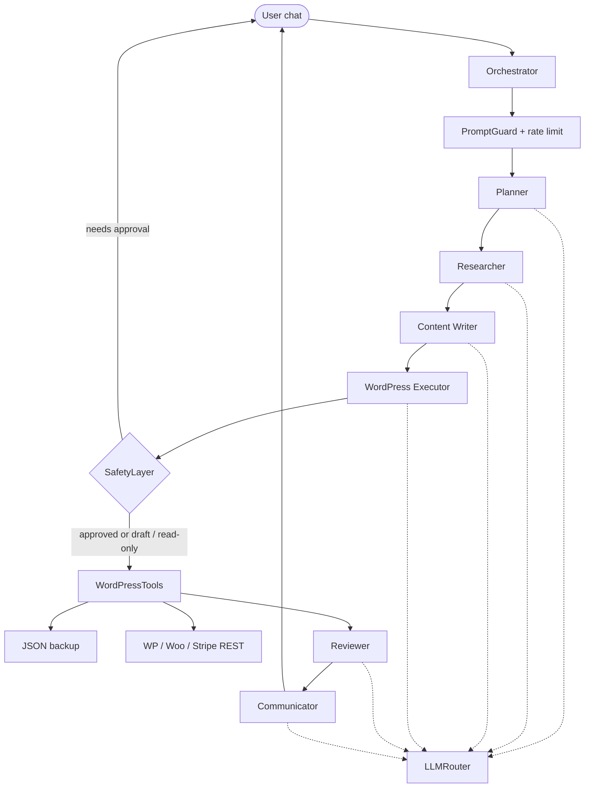

# WordPressGenius

> Operate WordPress and WooCommerce from chat. Drafts are free. Publishes, deletes, and refunds wait for approval and a JSON backup.

WordPressGenius is a LangGraph multi-agent operator for WordPress and WooCommerce. You chat in plain English. It plans the work, drafts the content, and asks before it touches anything live.

## Problem

Small-store operators live in WordPress admin, WooCommerce, Stripe, and a pile of plugin dashboards. Asking an LLM to "just handle it" is unsafe: a model that can publish, delete, or refund will eventually do it at the wrong time.

WordPressGenius is the opposite of an unconstrained WordPress copilot. The model proposes structured actions. Deterministic Python decides whether those actions may run. Publish, update, delete, settings, plugin changes, WooCommerce writes, and Stripe refunds always wait for explicit approval. Before a gated write runs, the app snapshots whatever it is about to change.

This repo is a local, self-hosted operator — not a hosted multi-tenant SaaS.

## Architecture



Six agents, one LangGraph graph (`agents/crew.py`):

- **Planner** turns your message into a short list of structured actions. LLM when a key is configured, rule-based fallback when it is not.
- **Researcher** checks the WordPress connection, pulls site context and memory, and can run a read-only DuckDuckGo search for external facts.
- **Content Writer** drafts Gutenberg-compatible copy for new posts and pages.
- **WordPress Executor** re-evaluates the plan through `SafetyLayer`, snapshots backups, then runs approved actions through the REST API.
- **Reviewer** checks what the API actually returned.
- **Communicator** tells you what happened in plain English.

The LLM never decides what is safe. `SafetyLayer` (`core/safety.py`) is deterministic Python. The Executor's LLM pre-flight check is advisory only — it can flag a concern, it cannot skip a gate.

See `docs/ARCHITECTURE.md` for the module map.

## Security model

Enforced in code, not prompts:

- **Approval.** Draft create runs without extra approval. Publish (including `status: publish` on new content), update, delete, settings, theme, plugin, SEO writes, bulk price, WooCommerce writes, plugin actions, undo, and Stripe refunds require approval. Offline golden-prompt evals in `evals/` assert this against a mocked model that often labels the work low-risk.
- **Backup.** Before a gated write, `tools/backups.py` reads the current resource and writes a JSON snapshot to `data/backups/`. If the resource cannot be read, the snapshot records that.
- **Permissions.** Three layers: app role (`viewer` / `editor` / `admin`), WordPress roles from `users/me`, and WordPress capabilities when the site exposes them.
- **Auth.** YAML users in `config/users.yml`. New hashes are salted Argon2id. Legacy unsalted SHA-256 hex digests still verify and are transparently rehashed on login.
- **Secrets.** WordPress credentials and saved sites are Fernet-encrypted on disk. Set `CREDENTIAL_ENCRYPTION_KEY` so the key survives restarts. Credentials are redacted before memory, the activity log, or the audit log.
- **Input.** `PromptGuard` normalizes Unicode, strips zero-width characters, and blocks instruction-override, secret-exfiltration, and mass-destruction language.
- **Audit.** Hash-chained JSONL at `data/audit_log.jsonl` with `verify()`.

## Clone and run

You need Python 3.10 or newer.

```bash
git clone https://github.com/DannyBarren/WordPressGenius.git
cd WordPressGenius
cp .env.example .env
python launch.py
```

`launch.py` installs the Streamlit bootstrap if it is missing, opens a setup screen, installs `requirements.txt`, verifies imports, runs two readiness tests, then opens the chat UI at `http://localhost:8501`.

Manual equivalent:

```bash
python -m pip install -r requirements.txt
streamlit run app.py
```

Login is on by default. Copy the example users file and sign in:

```bash
cp config/users.example.yml config/users.yml
```

The example password is `change-me`. Change it before you expose the app to anyone:

```bash
python -c "from core.security import hash_password; print(hash_password('your-new-password'))"
```

Put the quoted Argon2id string in `config/users.yml` as `password_hash`. Roles are `viewer`, `editor`, and `admin`.

Then connect a WordPress site. In WordPress: Users → Profile → Application Passwords → create one. In the app sidebar: site URL, username, Application Password. Click "Test WordPress connection". Generate a persistent vault key:

```bash
python -c "from core.security import generate_fernet_key; print(generate_fernet_key())"
```

Put it in `.env` as `CREDENTIAL_ENCRYPTION_KEY`.

A step-by-step first-run walkthrough is in `docs/DEMO.md`.

## Tests and evals

```bash
python -m pytest -q
python -m evals
```

`pytest.ini` collects `tests/` and `evals/`. The suite mocks the WordPress REST API with `responses`. No live site or API key is required. `evals/` is a golden-prompt harness: a scripted planner returns fixture plans, including adversarial low-risk labels, and `SafetyLayer` must still require approval for publish, delete, refund, and other writes.

CI (`.github/workflows/test.yml`) compiles sources, runs pytest, then runs `python -m evals`. Dependabot watches pip, GitHub Actions, and Docker.

## LLM providers

Works with no API key. You get the rule-based planner and template copy.

Add one key and every agent uses it. Supported providers: OpenAI, Anthropic, Groq, Google Gemini. Groq and Gemini run through their OpenAI-compatible endpoints. Pick the provider in the sidebar or in `.env`:

```bash
LLM_PROVIDER=openai
OPENAI_API_KEY=your-key
OPENAI_MODEL=gpt-4o-mini
```

Cost-aware routing is built in. Planner, Researcher, Executor pre-flight, and Reviewer run on a cheap fast tier. Content Writer runs on the premium tier. Override with `LLM_FAST_MODEL` / `LLM_PREMIUM_MODEL`.

## Cost notes

These are **estimates**, not measured production spend. No API key means **$0** model cost.

| Path | Estimate | Basis |
| --- | --- | --- |
| Rule-based planner + template copy | $0 | No provider call |
| Draft a short post (fast planner + premium writer, OpenAI defaults) | roughly $0.01–$0.05 | Typical chat turn: planner JSON + one writer completion, 1–3k tokens combined. Uses public `gpt-4o-mini` / `gpt-4o` list prices; your bill depends on prompt length and research. |
| Read-only question with no writer | well under $0.01 | Fast-tier JSON only |
| Groq / Gemini flash tiers | often near $0 on free/dev quotas | Provider-specific; treat as unknown until you measure |

Web search (DuckDuckGo) has no LLM fee. WordPress REST calls are your hosting cost, not a model cost. Set spend caps on the provider side if you put a key in a shared environment.

## What it can do

- Create draft posts and pages. Update or delete content after approval.
- WooCommerce: read products, orders, categories, tags, variations, low stock, and redacted customer data. Create, update, delete products, set stock, change order status, and run bulk price/stock/status changes after approval.
- Stripe through the WooCommerce gateway: read status and transactions, process refunds after approval. It never needs your Stripe secret key.
- Plugin framework: `PLUGIN_READ` (read-only) and `PLUGIN_ACTION` (approval-gated) for WooCommerce, Elementor, Yoast/Rank Math, Wordfence/Sucuri/Solid, Gravity Forms/WPForms/CF7, UpdraftPlus/LiteSpeed/WP Rocket, and ACF.
- Undo the last supported change from the latest JSON snapshot: posts, pages, settings, WooCommerce products/orders, and plugin activation status.
- Long-term memory in `data/site_memory.json` with TF-IDF recall into the Researcher.
- Multi-site vault, per-user login, hash-chained audit log, per-user rate limiting, prompt guardrails.

## Trade-offs

- **Streamlit vs a split API.** One process is easy to run and demo. It is a poor fit for multi-tenant SaaS, background workers, or horizontal scale.
- **YAML Argon2 auth vs an identity provider.** Enough for a trusted small team. Not SSO, not MFA, not account recovery.
- **JSON REST snapshots vs a full WordPress backup.** Fast and targeted. They do not replace UpdraftPlus / host backups. Refunds cannot be undone once Stripe accepts them.
- **Deterministic safety vs trusting the model.** The gate cannot be talked out of approval. The planner can still pick the wrong id or the wrong operation; a human has to read the approval card.
- **Rule planner vs LLM planner.** No key means keyword routing. That is cheap and testable, and it collides on messy phrasing.
- **Plugin REST vs a companion plugin.** Many plugins expose little or no public REST. Handlers degrade to dashboard steps instead of pretending they succeeded.
- **Argon2id memory cost vs unsalted SHA-256.** Login is slower and safer. Legacy hashes still work so existing `users.yml` files do not lock people out.

## Known failure modes

- PromptGuard refuses mass-delete wording (`delete all posts`) before a plan exists. Narrow deletes (`delete post #19`) still plan and wait for approval.
- The rule planner is keyword-based. "Update stock" and "update the about page" share verbs; tests cover the current branches, not every English sentence.
- The LLM planner can invent ids or choose `read_only` when you wanted a write. Safety still gates writes; it cannot invent the correct target.
- Role checks are coarse when the site does not expose capabilities.
- Undo does not cover every WooCommerce variation or plugin write. Verify big rollbacks on staging.
- Losing `CREDENTIAL_ENCRYPTION_KEY` makes the credential and site vaults unreadable.
- Analytics summaries depend on what installed plugins expose over REST.
- Streamlit reruns the script on each interaction. Session state lives in the UI process, not a shared store (`redis` is reserved for later).

## Docker

```bash
docker compose up --build -d
```

Streamlit UI on port 8501, FastAPI health on 8081, Redis alongside. See `PRODUCTION.md` for secrets, reverse proxy, and backup notes.

Local WordPress + WooCommerce test stack:

```bash
docker compose -f docker-compose.test.yml up
```

## Stack

Pinned in `requirements.txt`:

- Streamlit — UI
- LangGraph — agent graph
- OpenAI and Anthropic SDKs — LLM providers (Groq and Gemini via OpenAI-compatible endpoints)
- requests, pydantic, python-dotenv — WordPress REST client and config
- duckduckgo-search, langchain-community — Researcher web search
- FastAPI, uvicorn — health endpoint (`health.py`)
- cryptography — Fernet credential and site vaults
- argon2-cffi — password hashing
- PyYAML — login users file
- redis — reserved for a future shared session/memory backend
- beautifulsoup4, python-slugify — content helpers
- sentry-sdk — optional error tracking, PII disabled
- pytest, responses, pip-audit — tests and dependency auditing

## What this is evidence of

- LangGraph multi-agent orchestration with structured state between nodes.
- A deterministic safety layer. Approval, backup, and permission decisions live in Python, not in the model.
- Offline golden-prompt evals that treat "the model said it was safe" as the attack, not the control.
- WordPress REST and WooCommerce (`wc/v3`) tooling with backups and undo.
- A mocked pytest suite that runs without a live WordPress site.

## Contributing

See `CONTRIBUTING.md`.

## License

MIT. See `LICENSE`.
